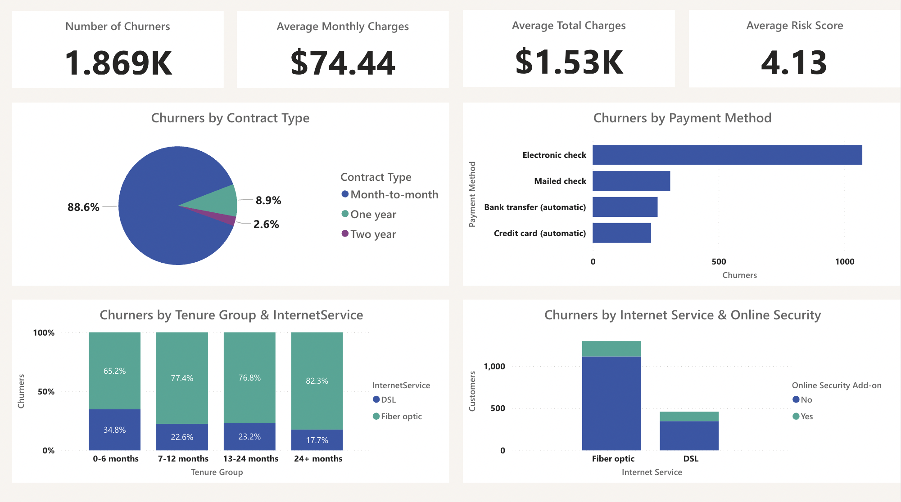
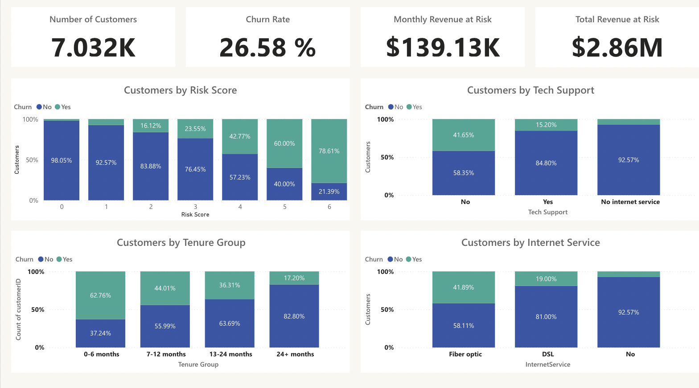

# Power BI Dashboard

A two-page report built on `Data/telco_churn_clean.csv`. Each page answers one business question.

## Page 1: Churners Profile

**Question:** who are the customers we lost?
Page-level filter: churned customers only (1,869).

| Visual | What it shows |
|---|---|
| KPI cards | 1,869 churners · $74.44 average monthly charges · $1.53K average lifetime revenue · 4.13 average risk score |
| Churners by contract type | 88.6% of churners were on month-to-month contracts |
| Churners by payment method | Electronic check accounts for more churners than all other methods combined |
| Churners by tenure group & internet service | Fiber optic makes up 65-82% of churners in every tenure group |
| Churners by internet service & online security | Most fiber optic churners had no online security add-on |

## Page 2: Churn Overview

**Question:** what separates churned from retained customers, and what does churn cost?
All 7,032 customers, split into churned vs retained.

| Visual | What it shows |
|---|---|
| KPI cards | 7,032 customers · 26.58% churn rate · $139.13K monthly recurring revenue lost with churned customers · $2.86M lifetime revenue collected from churned customers |
| Customers by risk score | Churn rises from 2% at score 0 to 79% at score 6, which validates the 6-signal risk score |
| Customers by tech support | 41.65% churn without tech support vs 15.20% with it |
| Customers by tenure group | Internet subscribers: 62.8% churn in the first 6 months, falling to 17.2% after 2 years |
| Customers by internet service | Fiber optic 41.89% vs DSL 19.00% vs no internet 7.43% |

## Design choices

- **A consistent two-colour palette.** On the overview page, blue is always retained and green is always churned.
- **100% stacked columns** on the overview page compare churn *rates* across groups of very different sizes.
- **KPI cards first, detail second:** each page opens with the headline numbers, then the visuals that explain them.
- Measures were cross-checked against the SQL queries ([SQL/README.md](../SQL/README.md)) so every number matches across tools.
