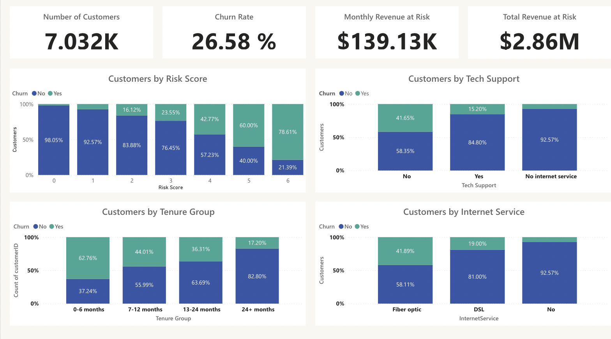

# Telco Customer Churn Analysis

An end-to-end churn analysis of 7,032 telecom customers using **SQL, Python and Power BI**: who churns, why they churn, what it costs, and which current customers to target next.



## Key results

| Metric | Value |
|---|---|
| Customers analysed | 7,032 |
| Churn rate | **26.6%** (1,869 customers) |
| Monthly recurring revenue lost to churn | **$139.1K** (30.5% of all monthly revenue) |
| Churn in the first 6 months of tenure | **53.3%** vs 14.0% after 2 years |
| Highest-risk segment | Fiber optic + month-to-month + electronic check: **60.4% churn** (1,307 customers) |
| Rule-based risk score (6 signals) | ROC AUC **0.825** |
| Logistic regression model | Test ROC AUC **0.836**; contacting the top 30% riskiest customers reaches **66%** of churners |

## Business questions and answers

**1. Who churns?** New customers on flexible plans. Month-to-month contracts churn at 42.7% (vs 2.8% on two-year contracts), fiber optic users at 41.9% (vs 19.0% on DSL) and electronic-check payers at 45.3% (vs 15-19% for other methods).

**2. When?** Early. Churn peaks in the first month (62%) and over half of customers in their first 6 months leave. Churners stay 18 months on average; retained customers 38.

**3. What does it cost?** Churners pay more per month ($74 vs $61) but generate less lifetime revenue ($1,532 vs $2,555) because they leave early. Churned customers took $139.1K of monthly recurring revenue with them.

**4. Who should we target now?** A predictive model flags **1,134 active customers** (22% of the active base, $86K of monthly revenue) who look like past churners. A conservative rule (risk score 5 or 6, where churn exceeds 60%) narrows this to 463 customers worth $36.8K a month.

## Recommendations

1. **Focus retention on the first 6 months:** onboarding check-ins and early-tenure offers.
2. **Move month-to-month customers to 1- or 2-year contracts** with a loyalty discount: contract length is the strongest lever after tenure.
3. **Investigate the fiber optic experience:** fiber customers churn about 3x as much as DSL customers even after accounting for price, which suggests a service-quality or competition issue.
4. **Encourage automatic payment and bundle tech support / online security** for high-risk customers. These are strong warning signs and cheap to act on.

## Approach

```
Raw data ──► Python: clean ──► SQL: segment & score ──► Python: EDA & model ──► Power BI: dashboard
```

| Step | Tool | What was done |
|---|---|---|
| Data preparation | Python | Converted `TotalCharges` to numeric, removed 11 not-yet-billed customers, added churn flag, tenure groups and risk score ([prepare_data.py](Python/prepare_data.py)) |
| Segmentation | SQL | Churn rates by contract, payment, internet service, support and tenure; high-churn segments; revenue impact ([churn_analysis.sql](SQL/churn_analysis.sql)) |
| Risk scoring | SQL + Python | A transparent 0-6 score built in three iterations; dropping `MonthlyCharges` raised ROC AUC from 0.817 to 0.825 |
| Exploratory analysis | Python | Correlation and Cramér's V to rank churn drivers and choose dashboard visuals ([01_eda.ipynb](Python/01_eda.ipynb)) |
| Predictive model | Python (scikit-learn) | Logistic regression vs random forest vs gradient boosting, threshold tuning, driver analysis and targeting efficiency ([02_churn_model.ipynb](Python/02_churn_model.ipynb)) |
| Dashboard | Power BI | Two pages: churner profile and churned-vs-retained overview ([PowerBI](PowerBI/README.md)) |

Full findings: **[summary_insights.md](summary_insights.md)**

## Repository structure

```
├── Data
│   ├── telco_churn_raw.csv       # original dataset (7,043 customers)
│   └── telco_churn_clean.csv     # cleaned dataset used everywhere (7,032 customers)
├── SQL
│   ├── churn_analysis.sql        # 19 analysis queries (MySQL 8)
│   └── README.md                 # SQL results and findings
├── Python
│   ├── prepare_data.py           # raw -> clean dataset
│   ├── 01_eda.ipynb              # exploratory analysis
│   ├── 02_churn_model.ipynb      # predictive model
│   └── README.md
├── PowerBI
│   ├── churners_profile.png      # dashboard page 1
│   ├── churn_overview.png        # dashboard page 2
│   └── README.md
├── summary_insights.md           # consolidated findings
└── requirements.txt
```

## How to reproduce

```bash
pip install -r requirements.txt
python Python/prepare_data.py          # rebuilds Data/telco_churn_clean.csv
jupyter notebook Python/               # run 01_eda.ipynb, then 02_churn_model.ipynb
```

For SQL, load `Data/telco_churn_clean.csv` into a MySQL 8 table named `telco` (schema at the top of `churn_analysis.sql`) and run the queries in order.

## Data

[IBM Telco Customer Churn](https://www.kaggle.com/datasets/blastchar/telco-customer-churn) sample dataset: one row per customer with demographics, account details (tenure, contract, billing, charges), subscribed services and whether the customer left in the last month.

## Skills demonstrated

- **SQL:** aggregation, segmentation, `CASE` logic, window functions (`RANK`), views, subqueries
- **Python:** pandas, data cleaning, statistical association (Cramér's V), scikit-learn pipelines, cross-validation, model evaluation (ROC/PR AUC, gains), permutation importance
- **Power BI:** KPI cards, segmented visuals, page-level filters
- **Business analysis:** turning findings into revenue impact and targeted recommendations
